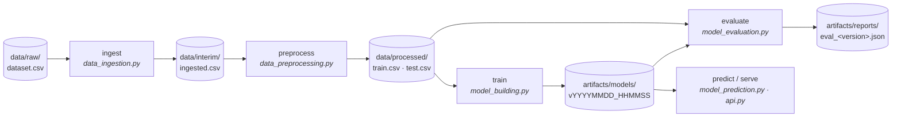
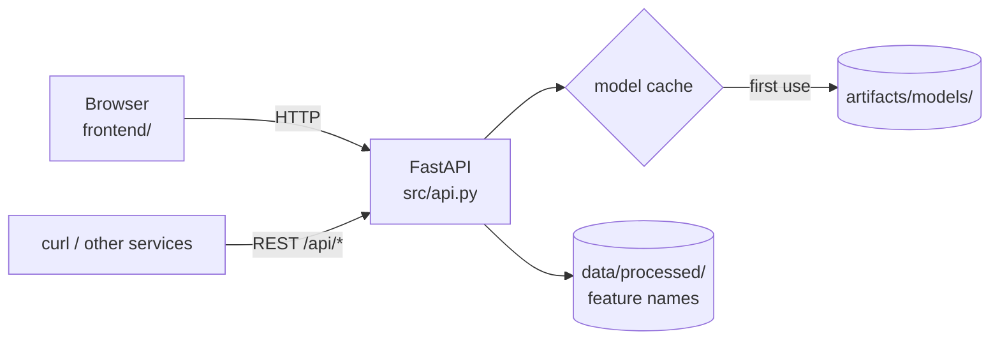

<div align="center">


<br />

<table>
<tr>
<td align="center" width="105"><a href="https://www.python.org/"><br /><sub><b>Python</b></sub></a></td>
<td align="center" width="105"><a href="https://scikit-learn.org/"><br /><sub><b>scikit-learn</b></sub></a></td>
<td align="center" width="105"><a href="https://pandas.pydata.org/"><picture><source media="(prefers-color-scheme: dark)" srcset="https://cdn.simpleicons.org/pandas/ffffff"></picture><br /><sub><b>pandas</b></sub></a></td>
<td align="center" width="105"><a href="https://fastapi.tiangolo.com/"><br /><sub><b>FastAPI</b></sub></a></td>
<td align="center" width="105"><a href="https://www.docker.com/"><br /><sub><b>Docker</b></sub></a></td>
<td align="center" width="105"><a href="https://github.com/"><picture><source media="(prefers-color-scheme: dark)" srcset="https://cdn.simpleicons.org/github/ffffff"></picture><br /><sub><b>GitHub</b></sub></a></td>
<td align="center" width="105"><a href="https://github.com/features/actions"><br /><sub><b>GitHub Actions</b></sub></a></td>
<td align="center" width="105"><a href="https://pytest.org/"><br /><sub><b>pytest</b></sub></a></td>
</tr>
</table>

<br />

[](https://github.com/chandanc5525/MLOps_Production_Template/actions/workflows/ci.yml)

**A clean, stage-based machine-learning pipeline with a CLI, a REST API, a web console and Docker, ready to fork and adapt.**

[Quick start](#quick-start) · [Architecture](#architecture) · [Folder guide](#folder-guide) · [CLI](#cli-reference) · [API](#web-console--rest-api) · [Docker](#docker) · [Extend it](#extending-the-template)

</div>

---


---
## Table of contents

- [Overview](#overview)
- [Tech stack](#tech-stack)
- [Architecture](#architecture)
- [Project structure](#project-structure)
- [Folder guide](#folder-guide)
- [Quick start](#quick-start)
- [CLI reference](#cli-reference)
- [Configuration](#configuration)
- [Model registry](#model-registry)
- [Web console & REST API](#web-console--rest-api)
- [Docker](#docker)
- [Testing & CI](#testing--ci)
- [Using your own data](#using-your-own-data)
- [Extending the template](#extending-the-template)
- [Troubleshooting](#troubleshooting)
- [Roadmap](#roadmap)
- [Contributing](#contributing)

---

## Overview

This template gives you a **working end-to-end ML workflow** you can run in one command and
then adapt to your own data. It deliberately avoids heavy frameworks so every step is easy to
read and change.

| Feature | Description |
|---|---|
| **Stage-based pipeline** | `ingest → preprocess → train → evaluate → predict`, one module per stage |
| **Config-driven** | Paths, split, model type and hyper-parameters live in one `config.yaml` |
| **Versioned model registry** | Every training run is saved as a timestamped model together with its metrics |
| **CLI** | A single `main.py` with a sub-command per stage plus `run-all` |
| **REST API + web console** | FastAPI backend with auto-generated docs and a no-build HTML/JS UI |
| **Docker** | Non-root image and a compose file with a service per stage |
| **Tests & CI** | pytest end-to-end tests and a GitHub Actions workflow (tests, pipeline smoke test, image build) |
| **Logging** | Console output plus a rotating log file in `logs/` |

It ships with a built-in demo dataset (scikit-learn's breast-cancer data) so you can see
everything working before plugging in your own CSV. On that dataset the default model
reaches roughly **95 % accuracy**.

---

## Tech stack

| | Tool | Used for | Where |
|---|---|---|---|
|  | **Python 3.10+** | Language for the whole pipeline, CLI and API | `main.py`, `src/` |
|  | **scikit-learn** | Model pipeline (scaler + classifier), metrics, train/test split | `model_building.py`, `model_evaluation.py`, `data_preprocessing.py` |
| <picture><source media="(prefers-color-scheme: dark)" srcset="https://cdn.simpleicons.org/pandas/ffffff"></picture> | **pandas** | Reading, cleaning and writing CSV data | `data_ingestion.py`, `data_preprocessing.py`, `model_prediction.py` |
|  | **FastAPI + Uvicorn** | REST API with auto-generated `/docs`, serves the web console | `src/api.py` |
|  | **Pydantic** | Request / response validation | `PredictRequest`, `PredictResponse` in `src/api.py` |
|  | **HTML5 / CSS / JavaScript** | Dependency-free web console | `frontend/` |
|  | **Docker + Compose** | Reproducible, non-root container; one service per stage | `docker/` |
|  | **GitHub Actions** | CI: tests, pipeline smoke test, image build | `.github/workflows/ci.yml` |
| <picture><source media="(prefers-color-scheme: dark)" srcset="https://cdn.simpleicons.org/github/ffffff"></picture> | **GitHub** | Source hosting and pull-request workflow | this repository |
|  | **pytest** | End-to-end pipeline and API tests | `tests/` |
|  | **YAML** | Single configuration file | `config.yaml` |

---

## Architecture

<p>&nbsp;&nbsp;&nbsp;&nbsp;<picture><source media="(prefers-color-scheme: dark)" srcset="https://cdn.simpleicons.org/pandas/ffffff"></picture></p>

### Pipeline

Each stage reads the previous stage's output file, so any stage can be re-run on its own.



### Serving



---

## Project structure

```
MLOps_Production_Template/
├── main.py                        # CLI entry point (one sub-command per stage)
├── config.yaml                    # single source of configuration
├── requirements.txt               # Python dependencies
├── pytest.ini                     # test configuration
├── Makefile                       # shortcuts for local and Docker workflows
├── .dockerignore  .gitignore
│
├── src/                           # pipeline code: one module per stage
│   ├── data_ingestion.py
│   ├── data_preprocessing.py
│   ├── model_building.py
│   ├── model_evaluation.py
│   ├── model_prediction.py
│   ├── api.py                     # FastAPI app + serves the frontend
│   └── utils.py                   # config, logging, JSON I/O, model registry
│
├── frontend/                      # web console (plain HTML / CSS / JS, no build step)
│   ├── index.html
│   ├── css/style.css
│   └── js/app.js
│
├── data/                          # datasets at each stage            (git-ignored)
│   ├── raw/  interim/  processed/
├── artifacts/                     # everything the pipeline produces  (git-ignored)
│   ├── models/                    # versioned models + metadata
│   └── reports/                   # evaluation reports, prediction files
├── logs/                          # rotating run log                  (git-ignored)
├── notebooks/                     # exploration
├── scripts/run_pipeline.sh        # full pipeline in one command
├── tests/                         # test_pipeline.py · test_api.py
├── docker/                        # Dockerfile · docker-compose.yml
├── assets/                        # logo.svg · banner.svg
└── .github/workflows/ci.yml       # GitHub Actions: tests, smoke test, image build
```

---

## Folder guide

A walk through every folder and what it is responsible for.

### Root files

| File | Purpose |
|---|---|
| `main.py` | CLI built with `argparse`. Each sub-command (`ingest`, `preprocess`, `train`, `evaluate`, `predict`, `run-all`, `serve`, `models`) calls one function from `src/`. Errors such as a missing file are printed cleanly and exit with code 1. |
| `config.yaml` | Everything you are expected to edit: data paths, target column, split, model type and parameters, artifact folders, server host/port. |
| `requirements.txt` | `scikit-learn`, `pandas`, `joblib`, `pyyaml`, `fastapi`, `uvicorn`, `pytest`, `httpx`. |
| `Makefile` | Short aliases (`make run-all`, `make serve`, `make docker-serve`, ...). See [Make targets](#make-targets). |
| `pytest.ini` | Puts the project root on the import path and points pytest at `tests/`. |

<p></p>

### `config.yaml`

See the full key reference in [Configuration](#configuration).

<p>&nbsp;&nbsp;&nbsp;&nbsp;<picture><source media="(prefers-color-scheme: dark)" srcset="https://cdn.simpleicons.org/pandas/ffffff"></picture></p>

### `src/` : the pipeline

| Module | Stage | What it does | Reads → Writes |
|---|---|---|---|
| `data_ingestion.py` | 1 · Ingest | Loads the raw CSV, checks it is non-empty and contains the target column. With `--demo` it first generates the demo dataset (569 rows, 31 columns). | `data/raw/dataset.csv` → `data/interim/ingested.csv` |
| `data_preprocessing.py` | 2 · Preprocess | `clean_data()` removes duplicate rows and rows with no label, rejects non-numeric feature columns with a clear message, and median-imputes missing values. Then a **stratified** train/test split using `test_size` and `random_state`. | `data/interim/ingested.csv` → `data/processed/train.csv`, `test.csv` |
| `model_building.py` | 3 · Train | Builds a scikit-learn `Pipeline` (`StandardScaler` → classifier) from `config.yaml`, trains it and saves it as a **versioned** model. Supported types: `random_forest`, `logistic_regression` (extend the `MODELS` dict). | `train.csv` → `artifacts/models/<version>.joblib` + `.json`, `latest.txt` |
| `model_evaluation.py` | 4 · Evaluate | Computes accuracy, precision, recall and F1 (weighted) on the held-out test set. Metrics are saved next to the model and as a report. | `test.csv` + model → `artifacts/reports/eval_<version>.json` |
| `model_prediction.py` | 5 · Predict | Batch predictions from any CSV. A `target` column, if present, is ignored; a `prediction` column is appended. | CSV → CSV (or stdout) |
| `api.py` | Serve | FastAPI app factory `create_app()`. Validated request/response schemas, an in-memory model cache, JSON error handlers and static hosting of `frontend/`. | models + processed data → HTTP |
| `utils.py` | Shared | `load_config`, `get_logger` (console + rotating file, 1 MB × 3), `save_json` / `load_json`, and the registry helpers `resolve_version`, `load_model`, `list_versions`. | n/a |

<p>&nbsp;&nbsp;</p>

### `frontend/` : web console

A dependency-free single-page UI served directly by FastAPI. Edit the files and refresh; there is no build step.

| File | Role |
|---|---|
| `index.html` | Layout: status bar, *Registered models* table, *Predict* card with **Single record** and **Batch (CSV)** tabs. |
| `css/style.css` | Design tokens (colours, spacing) at the top; automatic light/dark theme via `prefers-color-scheme`. |
| `js/app.js` | Calls the API, builds the input form from the model's feature names, renders predictions and confidence, parses uploaded CSVs, shows API errors. |

<p>&nbsp;&nbsp;&nbsp;&nbsp;<picture><source media="(prefers-color-scheme: dark)" srcset="https://cdn.simpleicons.org/pandas/ffffff"></picture></p>

### `data/` : datasets

| Sub-folder | Contents | Written by |
|---|---|---|
| `raw/` | Your original CSV (`dataset.csv`) | you (or `ingest --demo`) |
| `interim/` | Validated copy of the raw data | `ingest` |
| `processed/` | `train.csv` and `test.csv` | `preprocess` |

Contents are git-ignored; only `.gitkeep` files are tracked so the folders exist after cloning.

### `artifacts/` : pipeline outputs

| Sub-folder | Contents |
|---|---|
| `models/` | `vYYYYMMDD_HHMMSS.joblib` (the trained pipeline), `vYYYYMMDD_HHMMSS.json` (metadata + metrics), `latest.txt` (pointer to the newest version) |
| `reports/` | `eval_<version>.json` evaluation reports and any prediction files you save |

### `logs/`

`mlops.log` holds one line per event from every stage (`timestamp | level | module | message`). The file rotates at 1 MB and keeps 3 backups, so it cannot grow without bound.

### `notebooks/`

Space for exploratory analysis. Not copied into the Docker image.

### `scripts/`

`run_pipeline.sh` runs `run-all --demo` followed by `models`. CI uses it as the pipeline smoke test.

<p>&nbsp;&nbsp;</p>

### `tests/`

| File | Covers |
|---|---|
| `test_pipeline.py` | Every stage in order, then `run-all` + batch prediction, using a temporary config so nothing touches your real data. |
| `test_api.py` | Frontend and `/docs` are served; models / features / sample / predict endpoints; input validation (schema errors, missing features, invalid version). |

<p></p>

### `docker/`

| File | Role |
|---|---|
| `Dockerfile` | `python:3.12-slim`, dependencies installed in a cached layer, runs as a **non-root** user, entrypoint `python main.py`. |
| `docker-compose.yml` | One service per stage plus `serve`; mounts `config.yaml`, `data/`, `artifacts/` and `logs/`. |

<p>&nbsp;&nbsp;</p>

### `.github/workflows/`

`ci.yml` runs tests, the pipeline smoke test and a Docker build. See [Testing & CI](#testing--ci).

### `assets/`

`logo.svg` (square MLOps logo) and `banner.svg` (README header).

---

## Quick start

<p>&nbsp;&nbsp;&nbsp;&nbsp;<picture><source media="(prefers-color-scheme: dark)" srcset="https://cdn.simpleicons.org/pandas/ffffff"></picture></p>

### Prerequisites

- Python **3.10+**
- (optional) Docker with Compose v2

### Run locally

```bash
git clone https://github.com/chandanc5525/MLOps_Production_Template.git
cd MLOps_Production_Template

python -m venv .venv && source .venv/bin/activate      # Windows: .venv\Scripts\activate
pip install -r requirements.txt

python main.py run-all --demo      # ingest → preprocess → train → evaluate on the demo dataset
python main.py models              # list trained models with their metrics
python main.py serve               # web console → http://127.0.0.1:5000  (API docs → /docs)
```

Expected output of `python main.py models`:

```
VERSION             TYPE                  ACCURACY  F1
v20261114_021604    random_forest         0.9474    0.9474
```

### Run with Docker

<p></p>

```bash
make docker-build
make docker-run-all        # train on the demo data
make docker-serve          # → http://localhost:5000
```

### Make targets

| Target | Command it runs |
|---|---|
| `make install` | `pip install -r requirements.txt` |
| `make ingest` · `preprocess` · `train` · `evaluate` | the matching CLI command (`ingest` uses `--demo`) |
| `make run-all` | `python main.py run-all --demo` |
| `make models` | list trained models |
| `make serve` | start the web console and API |
| `make test` | `pytest -q` |
| `make docker-build` · `docker-run-all` · `docker-serve` · `docker-shell` | Docker equivalents |

---

## CLI reference

```bash
python main.py [-c CONFIG] <command> [options]
```

| Command | Options | Description |
|---|---|---|
| `ingest` | `--demo` | Load and validate raw data (optionally generate the demo dataset first) |
| `preprocess` | | Clean, impute and split into train/test |
| `train` | | Train a model from `config.yaml` and register a new version |
| `evaluate` | `--version V` | Evaluate a version (default: latest) on the test set |
| `predict` | `--input F` `[--output F]` `[--version V]` | Batch predictions from a CSV |
| `run-all` | `--demo` | `ingest → preprocess → train → evaluate` |
| `serve` | `[--host H]` `[--port P]` | Start the web console and REST API |
| `models` | | List registered models with metrics |

`-c / --config` selects a different configuration file (default `config.yaml`).

---

## Configuration

<p></p>

All behaviour is controlled from `config.yaml`.

| Key | Default | Description |
|---|---|---|
| `data.raw_path` | `data/raw/dataset.csv` | Input CSV |
| `data.interim_path` | `data/interim/ingested.csv` | Output of ingestion |
| `data.train_path` / `data.test_path` | `data/processed/train.csv` / `test.csv` | Output of preprocessing |
| `data.target` | `target` | Label column name |
| `data.test_size` | `0.2` | Fraction held out for testing |
| `data.random_state` | `42` | Seed for the split |
| `model.type` | `random_forest` | `random_forest` or `logistic_regression` |
| `model.params` | `n_estimators: 100`, `max_depth: 5` | Passed straight to the scikit-learn estimator |
| `artifacts.model_dir` | `artifacts/models` | Where versioned models are stored |
| `artifacts.report_dir` | `artifacts/reports` | Where reports are written |
| `artifacts.log_file` | `logs/mlops.log` | Rotating log file |
| `serve.host` / `serve.port` | `127.0.0.1` / `5000` | Server address (`--host` / `--port` override) |

---

## Model registry

<p>&nbsp;&nbsp;&nbsp;&nbsp;<picture><source media="(prefers-color-scheme: dark)" srcset="https://cdn.simpleicons.org/pandas/ffffff"></picture></p>

The registry is just files on disk, which makes it easy to inspect, back up or swap for a remote store.

```
artifacts/models/
├── v20261114_021604.joblib    # trained scikit-learn Pipeline
├── v20261114_021604.json      # metadata
└── latest.txt                 # "v20261114_021604"
```

Metadata example:

```json
{
  "version": "v20261114_021604",
  "model_type": "random_forest",
  "params": { "n_estimators": 100, "max_depth": 5 },
  "metrics": { "accuracy": 0.9474, "precision": 0.9474, "recall": 0.9474, "f1": 0.9474 }
}
```

- Each `train` creates a **new** version; older versions are never overwritten.
- `metrics` is added when you run `evaluate`.
- Commands and API calls use `latest.txt` unless a version is given.
- Version names are validated against the pattern `vYYYYMMDD_HHMMSS`, so they can't be used to read arbitrary files.

---

## Web console & REST API

<p>&nbsp;&nbsp;</p>

Start it with `python main.py serve` (or `make docker-serve`).

| URL | What you get |
|---|---|
| `http://127.0.0.1:5000/` | Web console |
| `http://127.0.0.1:5000/docs` | Interactive Swagger UI (auto-generated) |
| `http://127.0.0.1:5000/openapi.json` | OpenAPI schema |

### Web console

- Table of registered models and their metrics
- Model selector (defaults to latest)
- **Single record** form generated from the model's features, with *Fill sample*
- **Batch** CSV upload with per-row prediction and confidence
- Automatic light / dark theme

### Endpoints

| Method | Path | Description |
|---|---|---|
| `GET` | `/api/health` | Service status and latest model version |
| `GET` | `/api/models` | Registered models with metrics |
| `GET` | `/api/features` | Feature names the model expects |
| `GET` | `/api/sample` | One example row from the test set |
| `POST` | `/api/predict` | Predict for one or more rows |

### Predict

```bash
curl -X POST http://127.0.0.1:5000/api/predict \
  -H "Content-Type: application/json" \
  -d '{
        "rows": [ { "<feature_1>": 1.0, "<feature_2>": 2.0 } ],
        "version": "v20261114_021604"
      }'
```

`version` is optional. Get the real feature names from `GET /api/features`, or copy a ready-made row from `GET /api/sample`.

Response:

```json
{
  "version": "v20261114_021604",
  "predictions": [1],
  "confidence": [0.93]
}
```

### Error codes

| Status | Meaning |
|---|---|
| `400` | Missing features, or an invalid model version |
| `404` | No trained model, or training/test data not found yet |
| `422` | Body doesn't match the schema (e.g. empty `rows`, non-numeric values) |

### Production run

```bash
uvicorn --factory src.api:create_app --host 0.0.0.0 --port 5000 --workers 2
```

Set `MLOPS_CONFIG=/path/to/config.yaml` to use a different configuration file.

---

## Docker

<p></p>

`config.yaml`, `data/`, `artifacts/` and `logs/` are mounted into the container, so outputs appear on your machine and configuration changes need no rebuild.

| Compose service | Runs | Notes |
|---|---|---|
| `mlops` | any CLI command you pass | e.g. `run --rm mlops models` |
| `ingest` | `ingest --demo` | |
| `preprocess` | `preprocess` | |
| `train` | `train` | |
| `evaluate` | `evaluate` | |
| `run-all` | `run-all --demo` | full pipeline |
| `serve` | `serve --host 0.0.0.0 --port 5000` | publishes port **5000** |

```bash
docker compose -f docker/docker-compose.yml run --rm mlops models
docker compose -f docker/docker-compose.yml run --rm mlops predict \
    --input data/raw/dataset.csv --output artifacts/reports/preds.csv
```

> `serve` needs a trained model, so run `make docker-run-all` before `make docker-serve`.

---

## Testing & CI

<p>&nbsp;&nbsp;</p>

```bash
make test        # or: pytest -q
```

The GitHub Actions workflow (`.github/workflows/ci.yml`) runs on every push and pull request:

| Job | Steps |
|---|---|
| **test** | install dependencies → `pytest -q` → `scripts/run_pipeline.sh` (full pipeline smoke test) |
| **docker** *(after test)* | build `docker/Dockerfile` → run `run-all --demo` inside the container |

---

## Using your own data

<p>&nbsp;&nbsp;&nbsp;&nbsp;<picture><source media="(prefers-color-scheme: dark)" srcset="https://cdn.simpleicons.org/pandas/ffffff"></picture></p>

1. Copy your CSV to `data/raw/dataset.csv` (or change `data.raw_path`).
2. Set `data.target` in `config.yaml` to your label column.
3. Make sure features are numeric: add encoding or feature engineering inside `clean_data()` in `src/data_preprocessing.py`. (Non-numeric columns stop the pipeline with a clear error until you do.)
4. Pick `model.type` and tune `model.params`.
5. Run `python main.py run-all` (without `--demo`).

---

## Extending the template

| I want to... | Do this |
|---|---|
| **Add a model** | Add it to the `MODELS` dict in `src/model_building.py`, then set `model.type` |
| **Add a pipeline stage** | Create `src/<stage>.py` with a function taking `cfg`, then add a sub-command in `main.py` |
| **Add feature engineering** | Extend `clean_data()` in `src/data_preprocessing.py` |
| **Track experiments / use a remote registry** | Replace `save_model` and `load_model` (MLflow, S3, ...) |
| **Change the UI** | Edit files in `frontend/`, then refresh the browser (no build) |
| **Add an endpoint** | Add a function in `create_app()` in `src/api.py` |

---

## Troubleshooting

| Message | Cause and fix |
|---|---|
| `Raw data not found: data/raw/dataset.csv` | Add your CSV there, or run with `--demo` |
| `Target column 'target' not found` | Set `data.target` in `config.yaml` to your label column |
| `Non-numeric feature columns [...]` | Encode them in `clean_data()` (`src/data_preprocessing.py`) |
| `No trained model found. Run: python main.py train` | Train first, e.g. `python main.py run-all --demo` |
| `Training data not found` in the console | Run `preprocess` (or `run-all`) so feature names exist |
| `Invalid model version` | Use a version listed by `python main.py models` |
| Port 5000 already in use | `python main.py serve --port 5001` |

---

## Roadmap

- [x] Stage-based pipeline with config
- [x] Versioned model registry
- [x] CLI, REST API and web console
- [x] Docker and GitHub Actions CI
- [ ] Experiment tracking (MLflow)
- [ ] Data versioning (DVC)
- [ ] Data / prediction drift monitoring
- [ ] API authentication
- [ ] Image publishing to a container registry

---

## Contributing

<p><picture><source media="(prefers-color-scheme: dark)" srcset="https://cdn.simpleicons.org/github/ffffff"></picture></p>

Contributions are welcome.

1. Fork the repository and create a branch: `git checkout -b feature/my-change`
2. Make your change and add or update tests
3. Run `make test`
4. Open a pull request

---

<div align="center">

Built by **[@chandanc5525](https://github.com/chandanc5525)** · If this template helps you, consider giving it a star

</div>